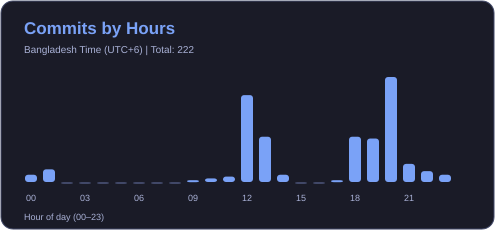
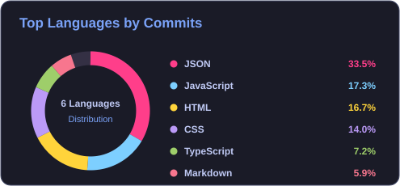

# Hi, I'm Nawsin Tabassum 👋

### Software Engineering Student | Aspiring Software Developer | AI & ML Enthusiast

Building practical, user-friendly software and learning something new every day.

  
  
  
  

---

## 👩‍💻 About Me

I am a Software Engineering student at **Daffodil International University (DIU)** with a strong interest in software development, web technologies, Artificial Intelligence, and Machine Learning. I enjoy exploring new technologies, solving problems, and turning ideas into practical applications.

- 🎓 Studying Software Engineering at DIU
- 🔭 Currently working on **NutriCare — Personalized Nutrition Planner**
- 🌱 Learning Full-Stack Web Development, TypeScript, AI & Machine Learning
- 💡 Interested in building useful, accessible, and user-friendly software
- 🧠 Strengthening programming, problem-solving, and software engineering fundamentals
- 🤝 Open to collaboration, internships, and learning opportunities

---

## 🛠️ Skills & Technologies

### 💻 Languages

  

### 🌐 Frontend

  

### ⚙️ Backend & Database

  

### 🔧 Tools

  

---

<h2 align="center">🚀 Featured Projects</h2>

A showcase of my projects and development journey.

<table>
<tr>
<td width="50%" valign="top">
<h3>🥗 NutriCare</h3>

<b>Personalized Nutrition Planner</b>

A personalized nutrition planning system designed to help users manage dietary preferences and receive suitable nutrition recommendations. <b>Currently in development.</b>

<b>Focus:</b> Personalized Nutrition · User Experience · Data Management

<b>Technologies:</b>

</td>
<td width="50%" valign="top">
<h3>📚 BookVerse</h3>

<b>Simple E-Commerce Book Store</b>

A simple online bookstore experience where users can browse books through a clean and easy-to-use interface.

<b>Focus:</b> E-Commerce · Product Browsing · Responsive Web Design

<b>Technologies:</b>

</td>
</tr>
<tr>
<td width="50%" valign="top">
<h3>💬 Real-Time Communication App</h3>

<b>Interactive Communication Platform</b>

A web application concept focused on enabling instant communication and interactive user experiences.

<b>Focus:</b> Real-Time Interaction · Web Application Development

<b>Technologies:</b>

</td>
<td width="50%" valign="top">
<h3>🎓 CampusConnect & UniSphere</h3>

<b>Academic & Campus Platform</b>

Academic and campus-focused web projects exploring practical solutions for student communities.

<b>Focus:</b> Student Community · Academic Solutions

<b>Technologies:</b>

</td>
</tr>
</table>

---

## 📚 Currently Learning

- 🌐 Full-Stack Web Development
- ⚛️ TypeScript and modern frontend development
- 🗄️ Database management and Prisma ORM
- 🤖 Artificial Intelligence & Machine Learning
- 🧠 Data Structures & Algorithms
- 🏗️ Software Engineering principles and best practices

---

## 📊 GitHub Statistics

  <table>
    <tr>
      <td width="50%" align="center">
        
      </td>
      <td width="50%" align="center">
        
      </td>
    </tr>
  </table>

<h3 align="center">🔥 Top Languages by Commits (All Time)</h3>

  

<h3 align="center">💻 Most Used Programming Languages</h3>

  

---

## 🔥 GitHub Contribution Streak

  

## 📅 GitHub Contributions

  

---

## 📈 GitHub Activity

  

---

## 🏆 GitHub Trophies

  

---

<h2 align="center">🐍 Contribution Snake</h2>

  <picture>
    <source media="(prefers-color-scheme: dark)" srcset="https://raw.githubusercontent.com/nawsintabassum/nawsintabassum/output/github-contribution-grid-snake-dark.svg"/>
    <source media="(prefers-color-scheme: light)" srcset="https://raw.githubusercontent.com/nawsintabassum/nawsintabassum/output/github-contribution-grid-snake.svg"/>
    
  </picture>

---

## 🎯 Goals

- 🚀 Build and complete meaningful real-world projects
- 💻 Grow as a Full-Stack Software Developer
- 🤖 Explore AI and Machine Learning
- 🧩 Improve problem-solving and programming skills
- 🌱 Contribute to open-source projects and keep learning
- 💼 Prepare for internship and entry-level software engineering opportunities

## 💡 Developer Mindset

> “Keep Learning, Keep Building, Keep Growing.”

I believe consistent learning, hands-on practice, and curiosity are the foundation of becoming a better developer.

---

## 🤝 Let's Connect

  

  

⭐ Thanks for visiting my profile!

