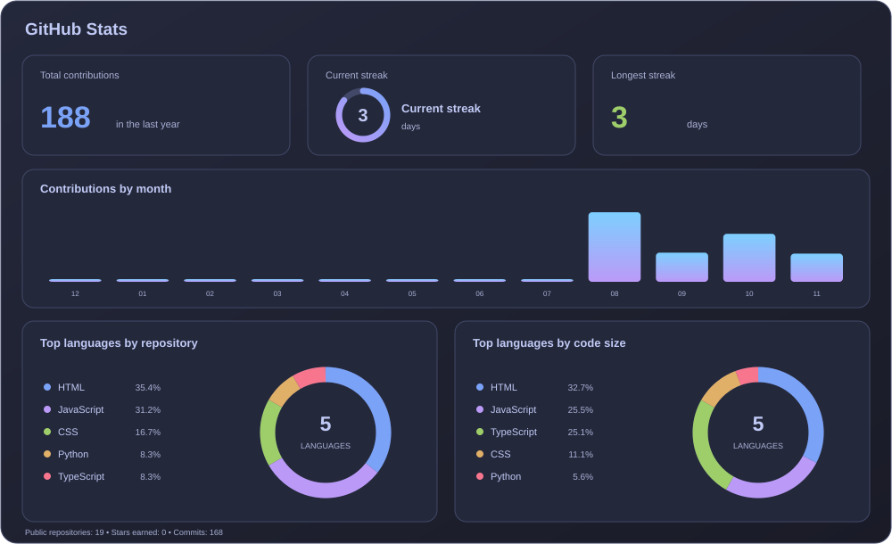
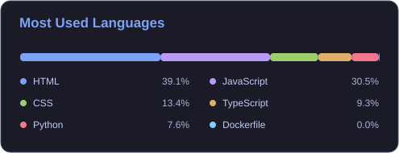
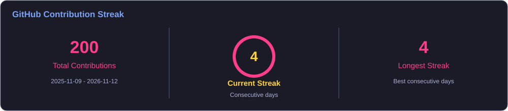
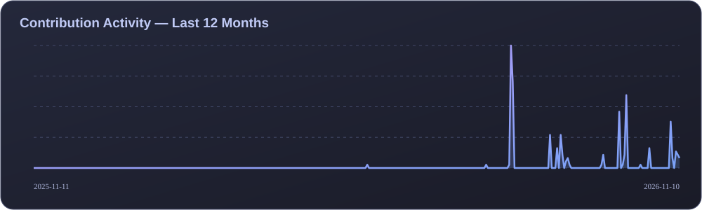

# Hi, I'm Nawsin Tabassum 👋

### Software Engineering Student | Aspiring Software Developer | AI & ML Enthusiast

Building practical, user-friendly software and learning something new every day.

  
  
  
  

---

## 👩‍💻 About Me

I am a Software Engineering student at **Daffodil International University (DIU)** with a strong interest in software development, web technologies, Artificial Intelligence, and Machine Learning. I enjoy exploring new technologies, solving problems, and turning ideas into practical applications.

- 🎓 Studying Software Engineering at DIU
- 🔭 Currently working on **NutriCare — Personalized Nutrition Planner**
- 🌱 Learning Full-Stack Web Development, TypeScript, AI & Machine Learning
- 💡 Interested in building useful, accessible, and user-friendly software
- 🧠 Strengthening programming, problem-solving, and software engineering fundamentals
- 🤝 Open to collaboration, internships, and learning opportunities

## 🛠️ Skills & Technologies

### 💻 Languages & Web

### 🌐 Frontend

### ⚙️ Backend & Database

### 🔧 Tools

---

## 🚀 Featured Projects

### 🥗 NutriCare — Personalized Nutrition Planner
A personalized nutrition planning system designed to help users manage dietary preferences and receive suitable nutrition recommendations. **Currently in development.**

**Focus:** Personalized Nutrition · User Experience · Data Management

**Technologies:** TypeScript · JavaScript · Tailwind CSS · SQL · Prisma ORM

### 📚 BookVerse — Simple E-Commerce Book Store
A simple online bookstore experience where users can browse books through a clean and easy-to-use interface.

**Focus:** E-Commerce · Product Browsing · Responsive Web Design

**Technologies:** HTML · CSS · JavaScript

### 💬 Real-Time Communication App
A web application concept focused on enabling instant communication and interactive user experiences.

**Focus:** Real-Time Interaction · Web Application Development

**Technologies:** JavaScript · Web Technologies

### 🎓 CampusConnect & UniSphere
Academic and campus-focused web projects exploring practical solutions for student communities.

**Technologies:** HTML · CSS · JavaScript

---

## 📚 Currently Learning

- 🌐 Full-Stack Web Development
- ⚛️ TypeScript and modern frontend development
- 🗄️ Database management and Prisma ORM
- 🤖 Artificial Intelligence & Machine Learning
- 🧠 Data Structures & Algorithms
- 🏗️ Software Engineering principles and best practices

---

## 📊 GitHub Statistics

  
  

## 🔥 Contribution Streak

  

## 📅 Contribution Overview

  

## 📈 GitHub Activity

  

## 🏆 GitHub Trophies

  

## 🐍 Contribution Snake

  <picture>
    <source media="(prefers-color-scheme: dark)" srcset="https://raw.githubusercontent.com/nawsintabassum/nawsintabassum/output/github-contribution-grid-snake-dark.svg"/>
    <source media="(prefers-color-scheme: light)" srcset="https://raw.githubusercontent.com/nawsintabassum/nawsintabassum/output/github-contribution-grid-snake.svg"/>
    
  </picture>

---

## 🎯 Goals

- 🚀 Build and complete meaningful real-world projects
- 💻 Grow as a Full-Stack Software Developer
- 🤖 Explore AI and Machine Learning
- 🧩 Improve problem-solving and programming skills
- 🌱 Contribute to open-source projects and keep learning

## 💡 Developer Mindset

> “Keep Learning, Keep Building, Keep Growing.”

I believe consistent learning, hands-on practice, and curiosity are the foundation of becoming a better developer.

## 🤝 Let's Connect

  
  
  
    
  
    
  ⭐ Thanks for visiting my profile!

